<p align="center">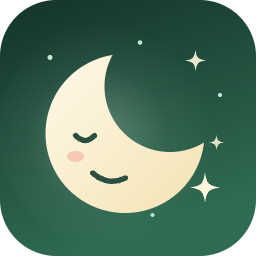</p>
<h1 align="center">Dreamscroll</h1>

<p align="center">
  <b>X and Instagram without the doom scroll.</b><br>
  Just the things you came for: your messages, notifications, saved posts, the people and posts you look up,<br>
  and the best of your feed. No endless timeline, no distractions.
</p>

<p align="center">
  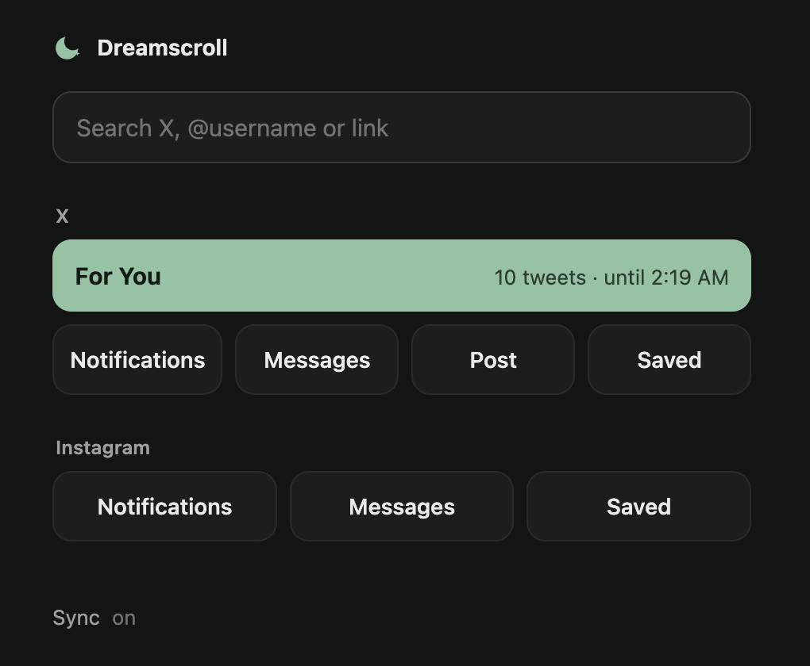
</p>

## Why

X is genuinely valuable. It's where I learn a lot, get a lot of my news, and come across interesting people and ideas. The problem is the doom scrolling: the feed never ends, and it quietly eats hours.

The top of your feed is the best of it. Dreamscroll gives you that part, so you still get 99% of what you came for, without the chance of falling into the scroll.

## What it does

Dreamscroll sits between you and the feeds. Everything **deliberate** still works: messages, notifications, saved posts, posting, profiles you look up, posts people send you, searches you type. Everything **ambient** (the home timeline, Explore, Reels, recommendation rails) is gone.

To keep up with what's going on, you get **the top of your For You feed**: a short batch of the best posts X would have shown you, on a calm page of its own. Read through it, open anything worth a closer look on X, and when the batch is done, it's done. No pull-to-refresh, no "show more".

### On X, just what you came for

<table>
  <tr>
    <td width="33%">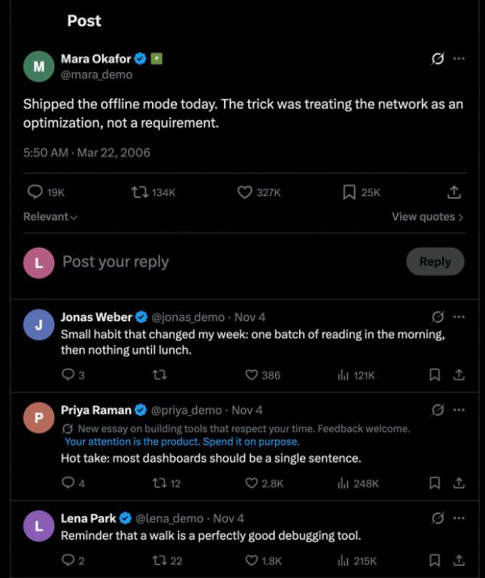</td>
    <td width="33%">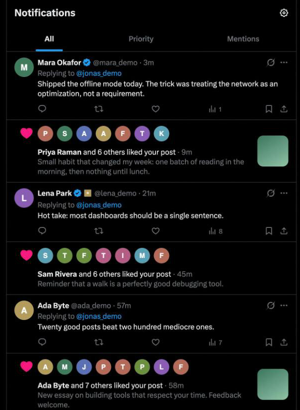</td>
    <td width="33%">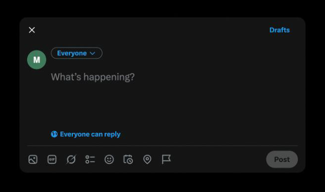</td>
  </tr>
  <tr>
    <td><b>Posts and conversations</b>, without the sidebar, trends or "who to follow".</td>
    <td><b>Notifications and messages</b>, and nothing to wander off into.</td>
    <td><b>Writing a post</b> without a feed behind the box.</td>
  </tr>
</table>

<sub>Names, posts and pictures in these screenshots are placeholders.</sub>

### One place to start

<table>
  <tr>
    <td width="50%">
      <picture>
        <source media="(prefers-color-scheme: dark)" srcset="docs/media/dashboard-dark.png">
        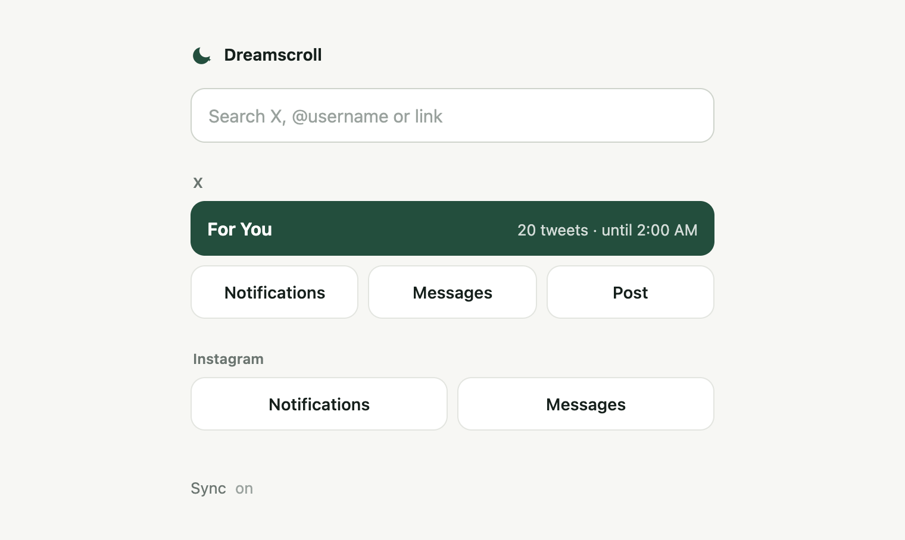
      </picture>
    </td>
    <td width="50%">
      <picture>
        <source media="(prefers-color-scheme: dark)" srcset="docs/media/search-dark.png">
        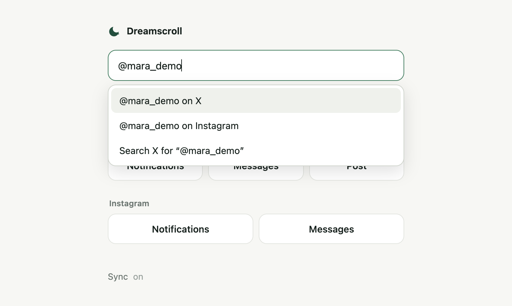
      </picture>
    </td>
  </tr>
  <tr>
    <td><b>One page instead of two feeds.</b> Visiting x.com or instagram.com (or clicking the toolbar icon) opens this page. Pick where you're going and you land right there.</td>
    <td><b>One box for everything.</b> Type a name, a search or paste a link.</td>
  </tr>
</table>

## On your iPhone too

The iPhone app is a small browser for X and Instagram with the same rules: you sign in inside the app, and only the parts you came for load. It also has the For You batch, a share target ("open this link in Dreamscroll" from any app), and an optional Safari blocker so the sites don't load in Safari.

<p align="center">
  <picture>
    <source media="(prefers-color-scheme: dark)" srcset="docs/media/iphone-dashboard-dark.png">
    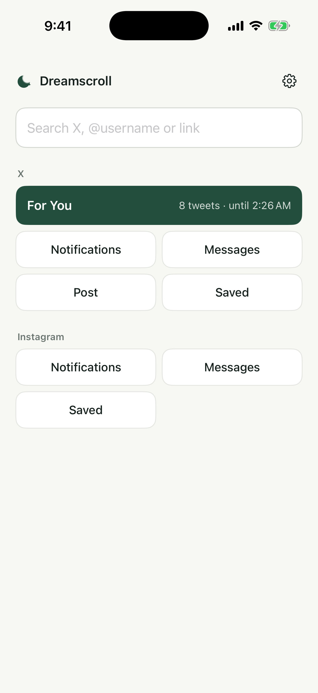
  </picture>
  &nbsp;
  <picture>
    <source media="(prefers-color-scheme: dark)" srcset="docs/media/iphone-feed-dark.png">
    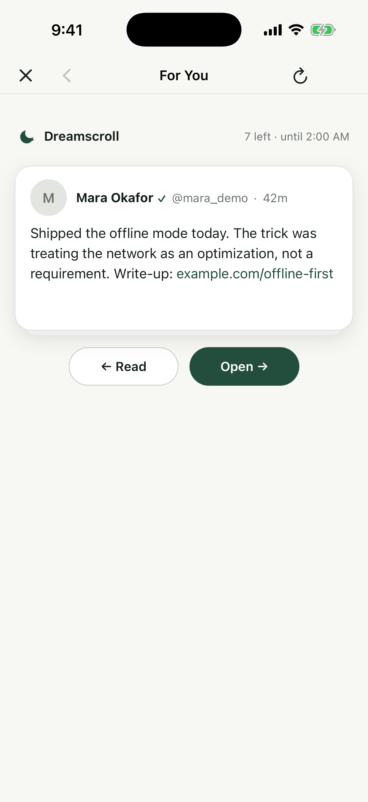
  </picture>
  &nbsp;
  <picture>
    <source media="(prefers-color-scheme: dark)" srcset="docs/media/iphone-settings-dark.png">
    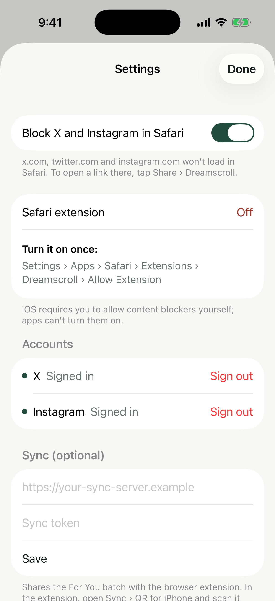
  </picture>
</p>

## Features

- **Feeds hidden, purpose kept.** Posts, threads, profiles, notifications, DMs, saved posts (X Bookmarks, Instagram Saved), the composer and typed searches work normally. Home timelines, Explore, Reels, stories and "Who to follow" don't.
- **The best of your feed, in batches.** A short batch of your top For You posts on Dreamscroll's own page, with links, previews, quotes and media. Then it's done for a while.
- **Read at your pace.** Mark posts read as you go, open any of them on X, and find the ones you've read underneath.
- **iPhone app** with in-app sign-in, a share extension and a Safari blocker.
- **Optional sync** shares the batch between your browser and your phone through a small server you run yourself (or [write yourself](docs/sync-api.md)). Set it up on the phone by scanning a QR code.
- **No accounts, analytics or tracking.** Dreamscroll talks only to X and Instagram (as your browser would, including the hidden page load that fetches a batch) and, if you set up sync, to the sync server you choose.

## Install

There's no store listing: you install it from this repository.

**Chrome (or any Chromium browser)**

1. Download or clone this repository.
2. Open `chrome://extensions`, turn on **Developer mode**, click **Load unpacked** and choose the `extension` folder.
3. Pin **Dreamscroll** and click it. Sign in to X and Instagram in that browser as usual.

**iPhone** (needs a Mac with Xcode)

See [INSTALL.md](INSTALL.md#iphone-app). In short: set your Apple team in `ios/Local.xcconfig`, generate the project with `xcodegen`, and run it on your phone from Xcode.

**Sync (optional)**

Without sync, each device keeps its own batch. To share one, deploy the server in [`sync/`](sync) (a Convex component, a few commands) or anything that speaks the [sync API](docs/sync-api.md).

<p align="center">
  <picture>
    <source media="(prefers-color-scheme: dark)" srcset="docs/media/sync-qr-dark.png">
    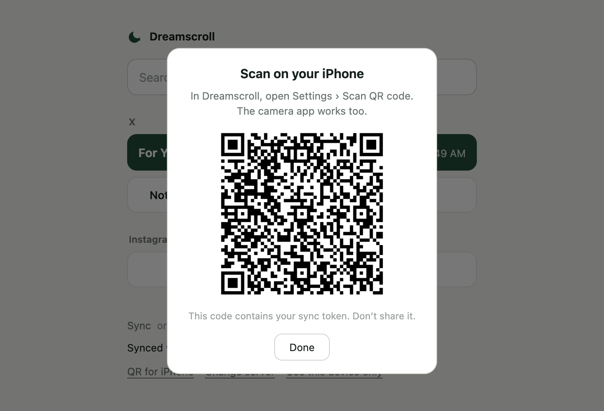
  </picture>
</p>

> Using an AI coding agent? Point it at [INSTALL.md](INSTALL.md). It's written to be followed step by step, with a check after each step.

## How it works (briefly)

- The extension blocks feed URLs with Chrome's network rules and hides recommendation UI on the pages it allows. Rules live in [`extension/policy.js`](extension/policy.js), shared with the iPhone app.
- A For You batch is captured by loading X's home page in a hidden window and keeping the timeline data X itself downloads. Tweets are sanitized before they're stored or shown.
- The iPhone app runs the extension's own scripts inside its web views, so both follow one set of rules.

More detail, including the X quirks this works around, is in [docs/how-it-works.md](docs/how-it-works.md).

## Limits

- This is a focus aid, not a lock. You can always turn it off, and it isn't meant to stop a determined you.
- It works by recognizing X's and Instagram's pages. When they change their markup, parts of it can break until it's updated.
- Not affiliated with X Corp. or Meta. Using it is subject to their terms, the same as using their websites.

## Development

```sh
bun install
bun run test         # unit tests (needs uv for the regex check)
bun run check        # syntax, generated rules and UI bundles are up to date
bun run build:ui     # after editing src/ui (React + Base UI)
bun run media        # regenerate the extension screenshots (Chrome)
```

Repository layout, conventions and the release process are in [AGENTS.md](AGENTS.md). Changes are listed in [CHANGELOG.md](CHANGELOG.md).

## License

[MIT](LICENSE)
